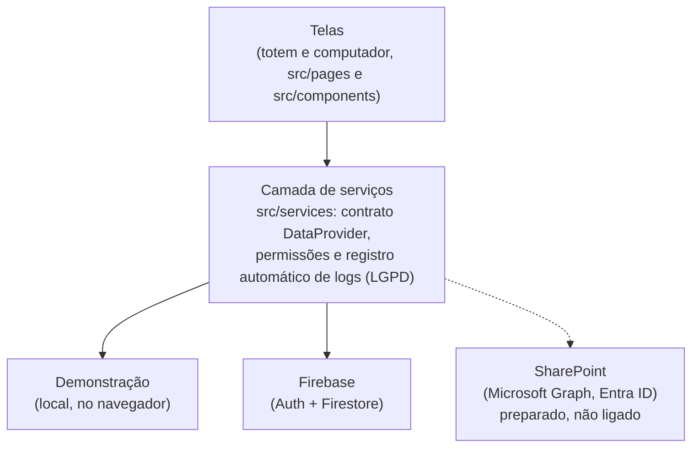

# SYNTRA e o Microsoft SharePoint

> **Situação atual:** a integração está **preparada, mas não ligada**. O provedor
> [`src/services/sharepoint/index.ts`](../src/services/sharepoint/index.ts) segue o mesmo contrato
> dos demais, porém cada função só lança "Integração SharePoint não configurada". Se o site for
> publicado com `VITE_DATA_PROVIDER=sharepoint`, ele mostra a tela
> **"Integração com SharePoint prevista para a implantação na PRF"** em vez de quebrar.

## Por que SharePoint

- **Aproveitar o Microsoft 365 da instituição, se houver.** Se a PRF já usa o Microsoft 365, o
  SharePoint, o Entra ID (contas e grupos) e o Purview (auditoria e rótulos de sigilo) já estão
  contratados: o custo extra de software tende a zero.
- **Dados dentro do ambiente institucional**, sob as políticas de segurança, backup e retenção
  que a TI já administra, em vez de um serviço de nuvem à parte.
- **Login único** com a conta Microsoft institucional: nada de senha nova para o servidor.
- **Arquivos e metadados juntos**: a biblioteca de documentos guarda o arquivo digitalizado e as
  colunas de busca (processo, matrícula, localização física) no mesmo item.
- **Sem trocar telas**: o SYNTRA já separa as telas da fonte de dados (veja a arquitetura abaixo).

O Firebase continua sendo o caminho do protótipo publicado; o SharePoint é o caminho da implantação.

## Arquitetura

`VITE_DATA_PROVIDER` escolhe a caixa de baixo: `local`, `firebase` ou `sharepoint`.

## Correspondência: SYNTRA → SharePoint

Site sugerido: **"SYNTRA – Gestão de Pessoas"**. Matrícula é sempre **texto de 4 dígitos**
(coluna de texto, nunca número, para preservar zeros à esquerda como em `0001`).
Colunas usadas em filtros (Matrícula, Status, Data) devem ser **indexadas**.

| Entidade no SYNTRA | SharePoint | Colunas principais |
|---|---|---|
| `Servidor` (ficha, blocos 1, 2, 3 e 5) | Lista **Servidores** | Matricula (texto, indexada), Nome, Cargo, Situacao, Email, CpfMascarado, Lotacao, DataIngresso, DataNascimento, TempoAverbadoAnos, Competencias (várias opções), Indicacoes (várias opções), FichaAtualizadaEm |
| Histórico de lotações (bloco 2) | Lista **MovimentacoesLotacao** | Servidor (pesquisa), Unidade, Inicio, Fim, Motivo |
| `Capacitacao` (bloco 4) | Lista **Capacitacoes** | Servidor (pesquisa), Nome, Area, CargaHoraria, Instituicao, DataConclusao, Documento (pesquisa no Acervo) |
| `Documento` | Biblioteca **Acervo Funcional** | Arquivo + Titulo, Tipo, NumeroProcesso, MatriculaServidor (indexada), NomeServidor, Lotacao, DataDocumento, DataArquivamento, LocalizacaoFisica, Status, NivelAcesso, PalavrasChave, OrigemCadastro |
| `Processo` | Lista **Processos** | NumeroProcesso (indexada), Assunto, MatriculaServidor, NomeServidor, Lotacao, Situacao, UnidadeAtual |
| Movimentações do processo | Lista **Movimentacoes** | Processo (pesquisa), Data, Unidade, Descricao |
| `Solicitacao` (autoatendimento) | Lista **Solicitacoes** + pasta **Autoatendimento** na biblioteca | Tipo, MatriculaServidor, NomeServidor, Lotacao, Dados do curso/documento, NomeArquivo, Status (indexada), CriadaEm, Origem, DecididaEm, DecididaPor, MotivoRecusa |
| `Extrato` | Lista **Extratos** | Title = código SYN-XXXX-XXXX, MatriculaServidor, NomeServidor, EmitidoEm, Secoes |
| `LogAcesso` | Lista **LogsAcesso** (só inclusão) | Usuario, Acao, Alvo, Detalhe, Resultados, Origem (totem/painel), Unidade, Data (indexada) |
| `Usuario` e perfil | **Entra ID**: grupos **SYNTRA-Policiais** e **SYNTRA-RH-Gestao** | Nome = displayName, Matrícula = employeeId, Unidade = officeLocation |

O comentário de cada função em `src/services/sharepoint/index.ts` diz a chamada do Microsoft Graph
correspondente (ex.: `GET /sites/{site}/lists/Servidores/items?$expand=fields&$filter=…`).

## Como ficaria o login

- O servidor entra com a **conta Microsoft institucional** (a mesma do e-mail), pelo
  **MSAL.js** (`@azure/msal-browser`), no lugar de matrícula + senha.
- O nível de acesso vem dos **grupos do Entra ID** (`GET /me/memberOf`):
  `SYNTRA-RH-Gestao` → RH / Gestão; `SYNTRA-Policiais` → Policial.
- A matrícula vem do atributo `employeeId` da conta (`GET /me`).
- **No totem**: sessão curta, saída automática de 2 minutos mantida e, se a TI preferir,
  login por crachá ou QR code integrado ao Entra ID. O navegador do totem fica em modo quiosque
  e não guarda a sessão ao fechar.

## Permissões por grupo

| Grupo | O que pode | Como o SharePoint garante |
|---|---|---|
| **SYNTRA-Policiais** (Policial) | Ler só a própria ficha, os próprios documentos (nunca sigilosos), processos e pedidos; criar pedidos em nome próprio; emitir o próprio extrato | Permissão por item (itens da própria matrícula) ou leitura mediada pelo app com filtro obrigatório pela matrícula da conta; rótulo de sigilo do Purview bloqueia documentos sigilosos |
| **SYNTRA-RH-Gestao** (RH / Gestão) | Ler e editar tudo, de todas as unidades; aprovar pedidos (nunca o próprio); ler logs; gerenciar membros dos grupos | Permissão de edição no site; a regra "ninguém aprova o próprio pedido" fica na camada de serviços e num fluxo do Power Automate que confere quem decidiu |
| Todos | Gravar o próprio log de acesso | Lista LogsAcesso com permissão só de **inclusão** (sem editar nem excluir) |
| Público (sem login) | Verificar um extrato pelo código | Função de servidor com permissão de aplicativo que devolve só os campos de verificação |

As mesmas regras de hoje (`src/services/permissoes.ts` e `firestore.rules`) servem de especificação.

## Passo a passo de implantação

1. **Confirmar com a TI** se a instituição tem Microsoft 365 com SharePoint e Entra ID.
2. **Criar o site** "SYNTRA – Gestão de Pessoas" e as listas/biblioteca da tabela acima, com as
   colunas indexadas.
3. **Criar os grupos** `SYNTRA-Policiais` e `SYNTRA-RH-Gestao` no Entra ID e preencher o
   `employeeId` (matrícula de 4 dígitos) das contas.
4. **Registrar o aplicativo** no Entra ID (SPA), com os escopos do Graph necessários
   (ex.: `Sites.ReadWrite.All`, `GroupMember.Read.All`, `User.Read`) e consentimento do administrador.
5. **Configurar as variáveis** `VITE_SHAREPOINT_*` (id do tenant, do aplicativo e do site) na
   Vercel ou no servidor interno. Nenhuma credencial no código.
6. **Implementar** as funções de `src/services/sharepoint/index.ts`, seguindo os comentários.
7. **Migrar os dados** (exportação do Firestore → importação em lote pelo Graph `$batch`),
   conferindo matrículas como texto.
8. **Homologar com o RH** usando `VITE_DATA_PROVIDER=sharepoint` num ambiente de teste.
9. **Piloto** em 1 ou 2 unidades com o totem físico e, depois, expansão.

## O que muda e o que não muda no código

**Não muda:**
- **Nenhuma tela** (`src/pages`, `src/components`, `src/hooks`): elas só conhecem `servicos`.
- O contrato `DataProvider` (`src/services/tipos.ts`).
- As regras de perfil (`src/services/permissoes.ts`), o registro automático de logs
  (`src/services/index.ts`), o autoatendimento (`src/services/autoatendimento.ts`) e as regras de RH
  (`src/lib/rh.ts`, `src/config/regrasRH.ts`).
- Os provedores local e Firebase, que continuam disponíveis.

**Muda:**
- O conteúdo de `src/services/sharepoint/index.ts` (hoje só lança o erro).
- A configuração: `VITE_DATA_PROVIDER=sharepoint` + variáveis `VITE_SHAREPOINT_*`.
- A dependência `@azure/msal-browser` (login), acrescentada no `package.json`.
- A tela de login passa a ter o botão "Entrar com a conta institucional" no lugar de matrícula e senha
  (única mudança visual, dentro do fluxo de login).
- A tela "Integração com SharePoint prevista" deixa de aparecer quando o provedor estiver implementado
  (basta remover o desvio em `src/App.tsx`).
